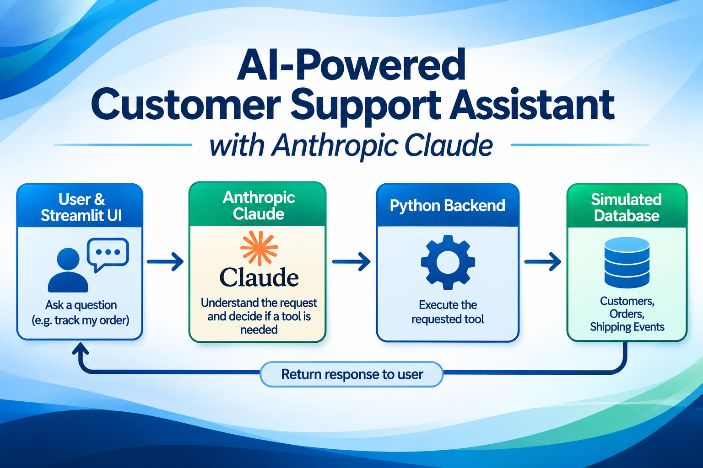
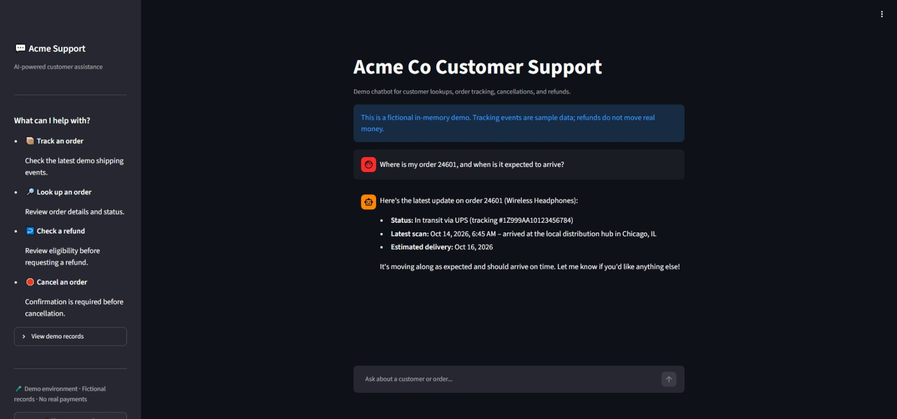
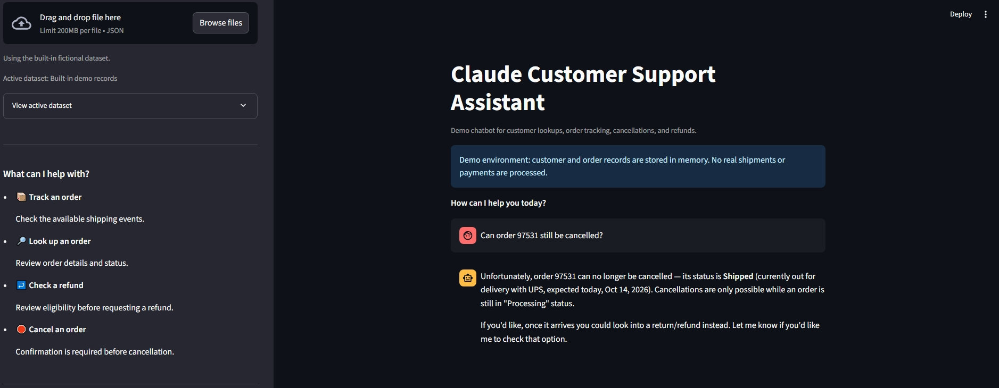
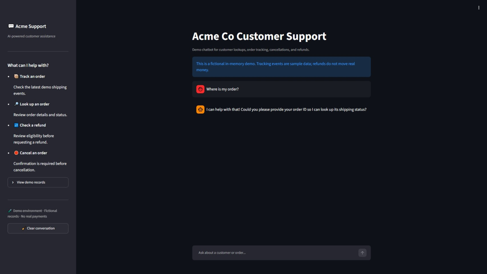

# AI-Powered Customer Support Assistant with Anthropic Claude

---    

    

---  

## Tags  

`Generative AI`, `Anthropic Claude`, `Python`, `Streamlit`, `AI Agents`, `Tool Calling`, `Customer Support Automation`, (`Conversational AI`, `API Integration`)

--- 

## TL;DR  

Customer-support teams handle recurring requests about order status, delivery updates, cancellations, and refunds. This project demonstrates how a **conversational AI assistant** can help with those workflows by connecting **Anthropic Claude to application-defined Python tools**.

The **Streamlit application** uses fictional customer and order records to demonstrate information lookup and simulated support operations. Claude interprets a request and may ask the application to call a tool; the Python backend validates the request, applies business rules, and returns a result for Claude to explain.

The project is intended for learning and demonstration. It does not access real customer accounts, connect to live shipping or payment services, or process actual refunds. (The project demonstrates tool use, backend integration, prompt design, and the steps needed to move from a prototype toward a production system.)    

---  

## Project goals (objectives)  

This project explores how to:  

- Connect a language model to application functions using tool calling.  
- Separate conversational interpretation from data access and business logic.  
- Demonstrate common customer-support workflows with fictional data.  
- Apply checks and confirmation steps to sensitive operations.  
- Identify the additional safeguards and integrations needed for a production system.  

---  

## The customer-support problem  

Many customer-support requests follow familiar patterns: customers ask where an order is, whether it can be cancelled, or whether it qualifies for a refund. An assistant can help demonstrate how these requests might be routed to application tools rather than answered from the language model’s general knowledge alone.

This distinction matters. The model can interpret a request and select a tool, but the application should remain responsible for accessing records, validating inputs, and enforcing operational rules.

---  

## Potential Users and Applications

This application is designed to demonstrate how AI-powered customer support can assist different types of users and organizations, including: (This demonstration may be useful to:)

- **Customer-support agents** exploring ways to streamline routine inquiries.  
- **E-commerce businesses and online retailers** considering AI-assisted order support.  
- **Small and medium-sized businesses** learning about customer-service automation.  
- **Customer-service managers** examining how tool-based assistants fit into support workflows.  
- **AI developers and students** learning about Claude, Python, Streamlit, and tool calling.  
- **Software developers** exploring how language models can interact with application functions.  

> Important: The current prototype is for demonstration and learning. It is not intended for direct use in live customer-support operations. 

---    

## System architecture

The application is organized into four components, each with specific responsability:

1. **Streamlit user interface** — accepts user messages and displays the conversation.
2. **Anthropic Claude** — interprets requests and returns either a conversational response or a structured tool-use request.
3. **Python backend** — defines and executes the tools, validates their inputs, and applies business rules.
4. **Simulated database** — provides fictional customer, order, and shipping information.

The language model does not directly access or modify the database. The Python application mediates each tool call, keeping data access and business operations under the control of the backend.

### Main Components

**1. Streamlit — User Interface**

Streamlit provides the web-based conversational interface. It allows users to submit natural-language requests, view the assistant's responses, and follow the progress of a support conversation.

The interface also displays the available demonstration information and provides a simple way to interact with the customer-support assistant without requiring a command-line interface.

When a user submits a message, Streamlit passes the conversation to the application logic, which prepares the request for Claude.

**2. Anthropic Claude — Language Model**

Claude is the conversational intelligence layer of the application.

It receives the conversation history, the system instructions, and the descriptions of the tools made available by the backend. Based on the user's request, Claude can either generate a direct response or request that the application execute one of the available tools.

For example, when a user asks about the status of an order, Claude can determine that order information is required and request the corresponding order-lookup tool.

Claude does not execute Python functions itself. It returns a structured tool-use request that the application must interpret and execute.

**3. Python Backend — Application Logic and Tool Execution**

The Python backend acts as the bridge between Claude and the simulated database.

It defines the available tools, including their names, descriptions, and input parameters. It also implements the functions that perform the actual operations.

When Claude requests a tool, the application passes the request to the backend. The backend validates and processes the arguments, executes the corresponding function, and returns the result.

This layer is also responsible for applying the application's business rules. For example, refund eligibility must be checked before a refund operation is performed. Sensitive actions, such as cancellations and refunds, are subject to confirmation safeguards.  

The assistant uses seven tools to support common customer-service tasks. All tool operations are executed by the Python backend against the simulated in-memory database. Refunds and order cancellations are demonstration operations and do not involve real payment or shipping services.

**4. Simulated Database — Customer and Order Information**

The simulated database provides the data used by the demonstration application. It (is embedded directly in the `support_backend.py` file) and consists of 10 fictional customer records and 12 order records.

It contains customer contact details, product and order information, shipping statuses, carrier and tracking details, estimated delivery dates, and tracking events. It also includes refund status and eligibility information.

The backend uses this data to answer customer questions and perform the operations supported by the prototype. For example, an order lookup retrieves the relevant order record, while a shipping-status request uses the associated shipping information and tracking events.

The database is intentionally simulated so that the application can demonstrate the interaction between an LLM and business operations without accessing real customer information or external payment and logistics services.


### Communication Between Components

The following diagram illustrates the main communication flow:  


        ┌──────────────────────────┐
        │       User               │
        │  Asks a support question │
        └────────────┬─────────────┘
                     │
                     ▼
        ┌──────────────────────────┐
        │      Streamlit UI        │
        │  Receives user request   │
        └────────────┬─────────────┘
                     │
               Send request
                     │
                     ▼
        ┌──────────────────────────┐
        │     Anthropic Claude     │
        │ Understands the request  │
        │ Selects the required tool│
        └────────────┬─────────────┘
                     │
                Tool request
                     │
                     ▼
        ┌──────────────────────────┐
        │      Python Backend      │
        │   Executes the tool      │
        │   Applies business rules │
        └────────────┬─────────────┘
                     │
                Read / Update
                     │
                     ▼
        ┌──────────────────────────┐
        │    Simulated Database    │
        │   Customers              │
        │   Orders                 │
        │   Shipping Events        │
        └────────────┬─────────────┘
                     │
                Return data
                     │
                     ▼
        ┌──────────────────────────┐
        │      Python Backend      │
        │   Returns tool result    │
        └────────────┬─────────────┘
                     │
                Tool result
                     ▼
        ┌──────────────────────────┐
        │     Anthropic Claude     │
        │  Generates final answer  │
        └────────────┬─────────────┘
                     │
                Final response
                     ▼
        ┌──────────────────────────┐
        │       Streamlit UI       │
        │   Displays response      │
        └──────────────────────────┘


*Figure 1 — Simplified system architecture showing how a user request travels through Streamlit, Anthropic Claude, the Python backend, and the simulated database before the final response is returned to the user. (Logical architecture and communication flow of the customer-support assistant.)*  

#### Architectural Design Considerations

The separation of the user interface, language model, backend logic, and data layer provides several advantages:

- **Separation of responsibilities:** Each component has a clearly defined role.
- **Controlled data access:** The model interacts with application data through predefined tools rather than direct database access.
- **Extensibility:** New tools can be introduced without redesigning the entire conversational interface.
- **Maintainability:** Business rules and database operations remain in the Python backend.
- **Safety:** Sensitive operations can be subject to explicit validation and confirmation.

The architecture is deliberately simple and suitable for demonstrating the fundamental concepts of tool calling. In a production system, the simulated database could be replaced by a persistent database, while the backend could be extended to integrate with real shipping, payment, and customer-management services.

Overall, this architecture demonstrates how a conversational LLM can be connected to existing application logic, transforming a basic chatbot into an assistant capable of retrieving information and performing controlled operations.

---  

### Request and Tool-Execution Workflow  

A typical interaction proceeds as follows:

1. **User request:** A user enters a message, such as “Can you check the shipping status of order 24601?”
2. **Request preparation:** The application sends the conversation, system instructions, and available tool definitions to Claude.
3. **Tool selection:** Claude determines whether it needs information or an operation from the backend and, if so, returns a structured tool request.
4. **Backend execution:** The application dispatches the request to the corresponding Python function.
5. **Data access and validation:** The backend looks up the relevant fictional record and applies the appropriate business rules.
6. **Tool result:** The application sends the backend result back to Claude.
7. **Response generation:** Claude explains the result in natural language, and Streamlit displays it to the user.

**In short:** User request → Claude tool request → backend validation and execution → tool result → Claude response.

>_Note: This interaction illustrates the distinction between language understanding and application execution: Claude determines what information or operation is needed, while the Python backend performs the actual work._  

---

### Handling Sensitive Operations

Not all support requests are simple information queries. Some requests can change the state of an order, particularly **cancellations and refunds**.

Cancellation and refund requests can change an order’s state, so they require more care than information lookups (incorporating additional safeguards). The intended workflow is to retrieve the order, check the relevant conditions, explain the proposed action, obtain explicit confirmation, and then perform the simulated operation through the backend.

This approach outlines that the backend should remain the authority for deciding whether an operation is allowed, thus it is responsible for enforcing the specific application's operational rule. A language model’s response should not, by itself, authorize a change to business records.

---    

## Implementation     
 
The application uses the Anthropic Python SDK to communicate with Claude. The API key is loaded from an environment variable rather than being included in the source code.

A system prompt guides the assistant to follow the support workflow, use tools when appropriate, check eligibility, and request confirmation before sensitive actions. Tool definitions describe the operations available to Claude, including their names, purposes, and input parameters. The Python backend implements and dispatches those operations.

The assistant uses **seven tools for customer-support tasks**. Tool operations run against the simulated, in-memory database in `support_backend.py`. The exact operations and business rules are defined by the project code. The tool execution process has been already described in the `Request and Tool-Execution Workflow paragraph`.  

## Simulated data

The demonstration database (is embedded in `support_backend.py` and) contains fictional customer and order records. The data includes customer contact details, products, order information, shipping statuses, carriers, tracking details, estimated delivery dates, and tracking events. It also includes information used to demonstrate refund and cancellation workflows.

This dataset allows users to explore tool calling and application logic without using real customer information or connecting to external payment or shipping services. Because the database is in memory, changes made during a session are not retained after the application restarts.

## Testing the Application  

The application was tested using a range of natural-language queries designed to evaluate its main customer-support functionalities and its ability to handle unsuccessful operations. The tests cover customer lookup, order retrieval, shipment tracking, order cancellation, and refund management. Particular attention was also given to negative test scenarios, including unknown customers, non-existent or invalid order identifiers, cancellation requests for already shipped orders, and queries containing insufficient information.  

The project’s example scenarios are intended to demonstrate both **successful workflows** and **cases where the assistant should not proceed**. They include (The following table summarizes the main testing scenarios and the expected behaviour of the assistant):  

| (Testing) Scenario | Expected behavior |
|---|---|
| Customer lookup | Return matching customer information or explain that no matching customer exists. |
| Order lookup | Return order details or indicate that the order could not be found. |
| Shipment tracking | Show available shipping status, delivery estimates, and tracking events. |
| Order cancellation | Check the order status, explain applicable conditions, and require confirmation before a simulated cancellation. |
| Refund eligibility | Check eligibility and provide the potential refund information available in the application. |
| Refund processing | Verify eligibility and require confirmation before recording a simulated refund. |
| Invalid or unknown identifiers | Explain that the requested customer or order could not be found. |
| Missing information | Ask the user for the information needed to continue. |

(These tests illustrate how the assistant combines natural-language understanding and tool selection with backend validation and business-rule enforcement. They also demonstrate that tool execution does not always result in a successful operation and that the application must handle such situations appropriately.)

These scenarios illustrate the roles of tool selection, backend validation, and business-rule enforcement. For additional example queries and expected responses, see the project’s **Example Queries for Testing the Application** section in the project's GitHub repository.  

---    

## Installation & Setup  

This publication includes a complete **GitHub code repository** with all source code, configuration files, and test cases.  

This section shows how to install dependencies, configure authentication, and run the full pipeline.

### Prerequisites:

- Python 3.10 or later  
- An Anthropic API key  
- Git  

### Clone the repository

```bash
git clone https://github.com/micag2025/AI_Customer_Support_Assitent_Anthropic.git
cd AI_Customer_Support_Assitent_Anthropic
```

### Create and activate a virtual environment  

**Windows:**

```bash
py -m venv .venv
.venv\Scripts\activate
```
**macOS or Linux:**  

```bash
python3 -m venv .venv
source .venv/bin/activate
```

### Install dependencies

```bash
python -m pip install streamlit anthropic python-dotenv
```

### Configure the Anthropic API key

Create a `.env` file in the project root:

```env
ANTHROPIC_API_KEY=your_actual_anthropic_api_key
```

Here the model 'claude-sonnet-5' has been selected and used. If the backend requires another configurable `model name`, also add the corresponding model setting used by `support_backend.py`. 

---  

## Running the Application

From the project directory, execute:

```bash
python -m streamlit run app.py
```

Streamlit will provide a local URL, typically:

```text
http://localhost:8501
```

Open the URL in a browser to interact with the customer-support assistant.  

---  

## Examples user interface  

The screenshots below illustrate the application’s interface and example support workflows.  

### Main Interface 

The Streamlit interface features a dark-themed layout with a sidebar for order tracking, customer lookups, refunds, and cancellations. The main area provides a chat input for users to interact with the AI assistant. A demo notice highlights that all records and transactions are simulated.

  

---  

### Customer lookup    

Screenshot of the Customer Lookup interface in the AI Customer Support Assistant, showcasing the streamlined workflow for retrieving customer information and supporting customer service interactions through an intuitive, AI-assisted dashboard.

    

---

### Order Information  

Order Information interface of the AI Customer Support Assistant, displaying essential order details such as status, purchased items, and delivery information to support fast and accurate customer assistance.

    

---  

### Shipping and tracking    

Shipping Tracking interface of the AI Customer Support Assistant, showing the shipment status, delivery progress, and key tracking information to assist customers with order updates.  

    

---  

### Order Cancellation  

Screenshot of the AI customer support assistant handling an order cancellation request, illustrating a clear and user-friendly support interaction for resolving customer issues efficiently.  

    

---  

### Refund Eligibility (and Processing)  

Screenshot of the AI Customer Support Assistant evaluating a customer’s refund request and displaying the eligibility outcome based on policy and account context.  

   

---  

### (Error Handling and Negative Test Case:) Missing required information   

Screenshot of the AI customer support assistant interface displaying a validation message for missing required information. The system prompts the user to complete the necessary details before continuing, highlighting the built-in guidance and data-quality checks.  

    

---  

## Safety and Limitations (and Workarounds)    

The project includes basic safeguards to illustrate responsible tool use, but it is not production-ready: (Therefore, limitations are related to:)

- **Fictional records**: Customer, order, and shipping details are simulated.  
- **In-memory storage**: Changes are lost when the application restarts.  
- **Simulated transactions**: Refunds do not transfer money, and shipping details are not retrieved from a live carrier.  
- **Demonstration safeguards**: Confirmation prompts illustrate a workflow; they do not replace authentication or authorization.  
- **Production security**: A deployed service would need secure data handling, access controls, monitoring, and robust validation.  
- **External integrations**: A real service would need persistent storage and carefully designed integrations with shipping and payment providers.  

_Note: These limitations are intentional and allow the project to demonstrate AI-powered customer-support workflows without interacting with real customer accounts or financial transactions._ 

---  

## Production roadmap    

Possible next steps for evolving the prototype into a more reliable, secure, and practical customer-support application include (The prototype could be extended into a production-ready customer-support application through the following improvements):

- **Replace the in-memory data with a persistent database** to retain customer information, orders, and transaction history across application sessions.    
- **Add secure user authentication and role-based permissions** to protect customer data and ensure that only authorized users can perform sensitive operations.   
- **Integrate with shipping providers for live tracking information** to retrieve live tracking information and delivery updates. - **Integrate with payment services using appropriate transaction controls** to support actual refund processing and transaction management.    
- **Add automated tests, monitoring, audit logging, and stronger error handling**.  
- **Review confirmation, authorization, privacy, and recovery workflows for every sensitive operation**.    

These changes would require careful design and testing; they are not provided by the current demonstration.

---  

## Contributing  

Contributions are welcome to improve the AI-Powered Customer Support Assistant with Anthropic Claude:   

1. Fork the GitHub repository.      
2. Create a feature branch:  
   
```bash  
git checkout -b feat/your-feature
```

3. Make and test your changes.    
4. Commit and push your branch.     
5. Open a pull request describing your contribution.  
   
Please follow the repository code style and add tests for significant changes.    

---  

## References  

- [Claude Platform documentation](https://platform.claude.com/docs/en/home)    
- [Anthropic](https://www.anthropic.com/)
- [Streamlit documentation](https://docs.streamlit.io/)    
- [Technical Evaluation Rubric](https://app.readytensor.ai/publications/technical-excellence-in-aiml-and-data-science-publications-an-evaluation-rubric-WsaE5uxLBqnH)  
- [Engage and Inspire: Best Practices for Publishing on Ready Tensor](https://app.readytensor.ai/publications/engage-and-inspire-best-practices-for-publishing-on-ready-tensor-SBgkOyUsP8qQ)
- [The Open Source Repository Guide](https://app.readytensor.ai/publications/best-practices-for-ai-project-code-repositories-0llldKKtn8Xb)
- [Markdown for Machine Learning Projects: A Comprehensive Guide](https://app.readytensor.ai/publications/markdown-for-machine-learning-projects-a-comprehensive-guide-LX9cbIx7mQs9)  

---  

## License  

This project is licensed under the MIT License. See the `LICENSE` file for details.  

---  

## Contact  

michelaagostini73@gmail.com

---

## Acknowledgements

An acknowledgement to **Ready Tensor developer community** for creating a vibrant ecosystem where AI professionals can share projects, insights, and innovations, playing a meaningful role in accelerating the advancement of AI technology and in shaping practical, real-world developer tools such as this project.  

---  
