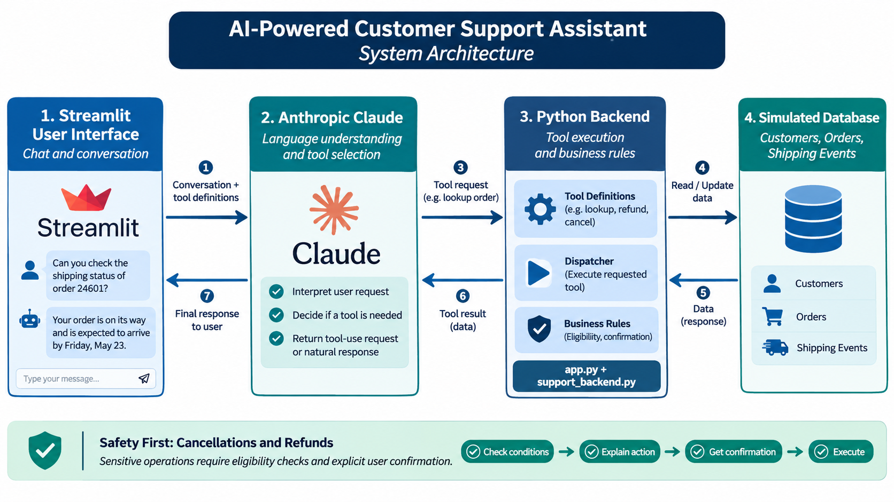
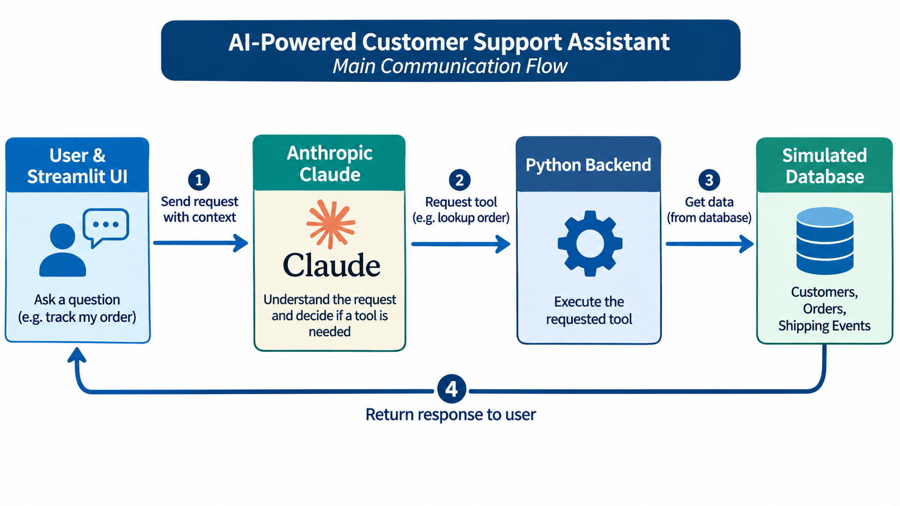
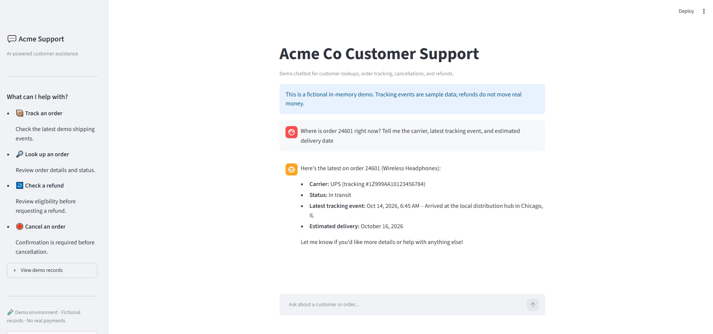
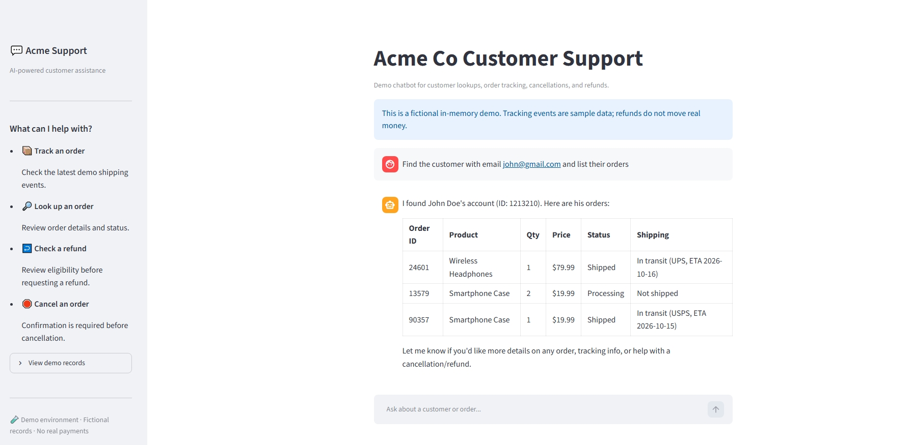
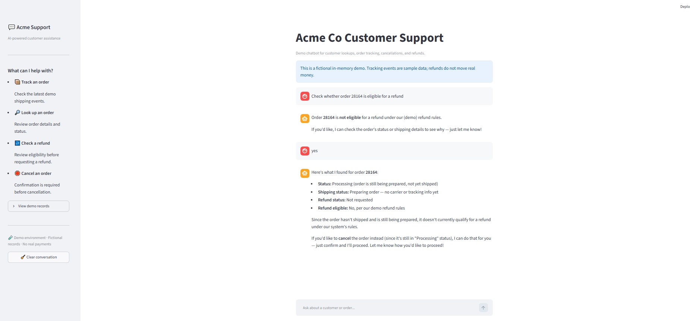

# Building an AI-Powered Customer Support Assistant with Anthropic Claude  

---    

## option1 

    

---  

## option2 

    

---  

## Tags  

`Generative AI`, `Anthropic Claude`, `Python`, `Streamlit`, `AI Agents`, `Tool Calling`, `Customer Support Automation`, (`Conversational AI`, `API Integration`)

--- 

## TL;DR

This is a practical AI engineering project showing how Anthropic Claude can interact with business tools to support customer service.

The fictional database is not a drawback and it lets readers explore the architecture and test order lookup, cancellation, and refund workflows without needing access to real customer data or payment systems.

The publication communicates three things:
1. **The customer-support problem**: Customer-support teams spend time on repetitive requests such as order tracking, cancellations, and refund eligibility.  
2. **The solution**: A Streamlit application connects Claude to Python functions that simulate these operations, with safeguards around sensitive actions.  
3. **The learning value**: The project demonstrates tool use, backend integration, prompt design, and the steps needed to move from a prototype toward a production system.  

---    

## Potential Users and Applications

This application is designed to demonstrate how AI-powered customer support can assist different types of users and organizations, including:

- **Customer support agents:** To handle routine customer inquiries and streamline support activities.
- **E-commerce businesses:** To assist customers with order management, shipping updates, and refund requests.
- **Online retailers:** To automate basic post-purchase customer support.
- **Small and medium-sized businesses (SMBs):** To explore AI-assisted customer service without requiring a large support team.
- **Customer service managers:** To understand how AI can improve support workflows and operational efficiency.
- **AI developers and students:** To learn how to build AI assistants using Anthropic Claude, Python, and tool calling.
- **Software developers:** To explore the integration of large language models (LLMs) with external tools and business applications.
 
> _Note: The current prototype is intended for demonstration and learning purposes, not direct use in live customer-support operations._  

---  

## System Architecture

The application is organized into four main components: a **Streamlit user interface**, the **Anthropic Claude language model**, a **Python backend**, and a **simulated database**.

Each component has a specific responsibility. Streamlit manages the interaction with the user, Claude interprets requests and determines when application tools are needed, the Python backend executes the requested operations, and the simulated database provides the customer, order, and shipping information.

A central design principle is that the language model does not directly access or modify the database. Instead, it communicates with the Python application through a structured tool-calling mechanism. This keeps data access and business operations under the control of the backend.

### Main Components

**1. Streamlit — User Interface**

Streamlit provides the web-based conversational interface. It allows users to submit natural-language requests, view the assistant's responses, and follow the progress of a support conversation.

The interface also displays the available demonstration information and provides a simple way to interact with the customer-support assistant without requiring a command-line interface.

When a user submits a message, Streamlit passes the conversation to the application logic, which prepares the request for Claude.

**2. Anthropic Claude — Language Model**

Claude is the conversational intelligence layer of the application.

It receives the conversation history, the system instructions, and the descriptions of the tools made available by the backend. Based on the user's request, Claude can either generate a direct response or request that the application execute one of the available tools.

For example, when a user asks about the status of an order, Claude can determine that order information is required and request the corresponding order-lookup tool.

Claude does not execute Python functions itself. It returns a structured tool-use request that the application must interpret and execute.

**3. Python Backend — Application Logic and Tool Execution**

The Python backend acts as the bridge between Claude and the simulated database.

It defines the available tools, including their names, descriptions, and input parameters. It also implements the functions that perform the actual operations.

When Claude requests a tool, the application passes the request to the backend. The backend validates and processes the arguments, executes the corresponding function, and returns the result.

This layer is also responsible for applying the application's business rules. For example, refund eligibility must be checked before a refund operation is performed. Sensitive actions, such as cancellations and refunds, are subject to confirmation safeguards.  

The assistant uses seven tools to support common customer-service tasks. All tool operations are executed by the Python backend against the simulated in-memory database. Refunds and order cancellations are demonstration operations and do not involve real payment or shipping services.

**4. Simulated Database — Customer and Order Information**

The simulated database provides the data used by the demonstration application. It (is embedded directly in the `support_backend.py` file) and consists of 10 fictional customer records and 12 order records.

It contains customer contact details, product and order information, shipping statuses, carrier and tracking details, estimated delivery dates, and tracking events. It also includes refund status and eligibility information.

The backend uses this data to answer customer questions and perform the operations supported by the prototype. For example, an order lookup retrieves the relevant order record, while a shipping-status request uses the associated shipping information and tracking events.

The database is intentionally simulated so that the application can demonstrate the interaction between an LLM and business operations without accessing real customer information or external payment and logistics services.


### Communication Between Components

The following diagram illustrates the main communication flow:  


        ┌──────────────────────────┐
        │       User               │
        │  Asks a support question │
        └────────────┬─────────────┘
                     │
                     ▼
        ┌──────────────────────────┐
        │      Streamlit UI        │
        │  Receives user request   │
        └────────────┬─────────────┘
                     │
               Send request
                     │
                     ▼
        ┌──────────────────────────┐
        │     Anthropic Claude     │
        │ Understands the request  │
        │ Selects the required tool│
        └────────────┬─────────────┘
                     │
                Tool request
                     │
                     ▼
        ┌──────────────────────────┐
        │      Python Backend      │
        │   Executes the tool      │
        │   Applies business rules │
        └────────────┬─────────────┘
                     │
                Read / Update
                     │
                     ▼
        ┌──────────────────────────┐
        │    Simulated Database    │
        │   Customers              │
        │   Orders                 │
        │   Shipping Events        │
        └────────────┬─────────────┘
                     │
                Return data
                     │
                     ▼
        ┌──────────────────────────┐
        │      Python Backend      │
        │   Returns tool result    │
        └────────────┬─────────────┘
                     │
                Tool result
                     ▼
        ┌──────────────────────────┐
        │     Anthropic Claude     │
        │  Generates final answer  │
        └────────────┬─────────────┘
                     │
                Final response
                     ▼
        ┌──────────────────────────┐
        │       Streamlit UI       │
        │   Displays response      │
        └──────────────────────────┘


*Figure 1 — Simplified system architecture showing how a user request travels through Streamlit, Anthropic Claude, the Python backend, and the simulated database before the final response is returned to the user. (Logical architecture and communication flow of the customer-support assistant.)*

### Request and Tool-Execution Workflow

A typical interaction follows these steps:

1. **User request:** The user enters a message in the Streamlit chat interface, such as: "Can you check the shipping status of order 24601?"

2. **Request preparation:** The application collects the conversation context and the available tool definitions and sends them to the Anthropic Claude API.

3. **Request interpretation:** Claude analyzes the message and determines that it needs order and shipping information. It returns a structured request to invoke the appropriate tool.

4. **Tool execution:** The Python application receives the tool request and dispatches it to the corresponding backend function.

5. **Database interaction:** The backend retrieves the relevant order and shipping information from the simulated database.

6. **Tool result:** The backend returns the retrieved information to the application, which sends the tool result back to Claude as part of the conversation.

7. **Response generation:** Claude interprets the tool result and generates a natural-language explanation.

8. **User feedback:** Streamlit displays the final response to the user.

This interaction illustrates the distinction between language understanding and application execution: Claude determines what information or operation is needed, while the Python backend performs the actual work.

### Handling Sensitive Operations

Not all support requests are simple information queries. Some requests can change the state of an order, particularly cancellations and refunds.

For these operations, the application incorporates additional safeguards. The assistant is instructed to check the relevant conditions and obtain explicit user confirmation before proceeding with a sensitive action.

The general workflow is therefore:

- Interpret the user's request.
- Retrieve the relevant order information.
- Check the applicable business conditions.
- Explain the proposed action to the user.
- Obtain explicit confirmation.
- Execute the operation through the backend.
- Report the result.

This approach is important because an LLM should not be treated as the authority for modifying business records. The backend remains responsible for enforcing the application's operational rules.

### Architectural Design Considerations

The separation of the user interface, language model, backend logic, and data layer provides several advantages:

- **Separation of responsibilities:** Each component has a clearly defined role.
- **Controlled data access:** The model interacts with application data through predefined tools rather than direct database access.
- **Extensibility:** New tools can be introduced without redesigning the entire conversational interface.
- **Maintainability:** Business rules and database operations remain in the Python backend.
- **Safety:** Sensitive operations can be subject to explicit validation and confirmation.

The architecture is deliberately simple and suitable for demonstrating the fundamental concepts of tool calling. In a production system, the simulated database could be replaced by a persistent database, while the backend could be extended to integrate with real shipping, payment, and customer-management services.

Overall, this architecture demonstrates how a conversational LLM can be connected to existing application logic, transforming a basic chatbot into an assistant capable of retrieving information and performing controlled operations.


## Implementation   
 
The application connects to the Anthropic Claude API using the Python SDK, with the API key securely loaded from an environment variable.   
A system prompt guides Claude to act as a customer-support assistant, follow business rules, verify eligibility for actions such as cancellations and refunds, and request user confirmation before executing sensitive operations.  
Tool definitions describe the functions available to Claude, including order lookup, shipping-status checks, cancellations, and refund-related operations.
When a user submits a request, Claude determines whether a tool is needed and, if so, returns a structured tool request. The Python backend dispatches the request, executes the corresponding function against the simulated database, and sends the result back to Claude. Claude then uses that result to generate a natural-language response displayed in the Streamlit interface.  

The tool execution process follows these steps:

- **User request**: The user submits a question or instruction through the Streamlit interface.  
- **Claude analysis**: The application sends the conversation, system prompt, and available tool definitions to Claude. Claude determines whether a tool is required.  
- **Tool request**: If a tool is needed, Claude returns a structured tool-use request specifying the tool name and its input parameters.  
- **Backend execution**: The Python backend receives the request, identifies the corresponding function, and executes it against the simulated database. Business rules and confirmation requirements are applied where relevant.  
- **Tool result**: The backend returns the execution result to the application, which sends it back to Claude as a tool result.  
- **Final response**: Claude uses the tool result to generate a natural-language answer, which is displayed to the user through Streamlit.  

> _Note : This process can repeat if Claude needs to call additional tools before responding. Importantly, Claude does not access the database directly; all database operations are handled by the Python backend through the defined tools._

---    

## Installation  

This section shows how to install dependencies, configure authentication, and run the full pipeline.

### Prerequisites:

- Python 3.10+    
- Anthropic Clauude API key    

### 1. Clone the repository

```bash
git clone https://github.com/micag2025/AI_Customer_Support_Assitent_Anthropic.git
cd AI_Customer_Support_Assitent_Anthropic
```

### 2. Create a virtual environment

On Windows:

```bash
py -m venv .venv
.venv\Scripts\activate
```

### 3. Install dependencies

```bash
python -m pip install streamlit anthropic python-dotenv
```

### 4. Configure the Anthropic API key

Create a `.env` file in the project root:

```env
ANTHROPIC_API_KEY=your_actual_anthropic_api_key
```

Here the model 'claude-sonnet-5' has been selected and used. If the backend requires another configurable `model name`, also add the corresponding model setting used by `support_backend.py`. 

---  

## Running the Application

From the project directory, execute:

```bash
python -m streamlit run app.py
```

Streamlit will start the application and provide a local URL, normally:

```text
http://localhost:8501
```

Open that address in your browser to interact with the customer-support assistant.  

---  

## Demonstration (Examples Usage UI)  

### Web UI   

The Streamlit interface features a dark-themed layout with a sidebar for order tracking, customer lookups, refunds, and cancellations. The main area provides a chat input for users to interact with the AI assistant. A demo notice highlights that all records and transactions are simulated.

  

---

### Example 1 Order lookup

> Can you check the details of order 24601? 

  

> prompt to be enclosed 

    

---  

### Example 2 Shipping information

> What is the shipping status of order 13579?

![sceentshot to be enclosed]   

---  

### Example 3 Refund eligibility

> Can you check whether order 97531 is eligible for a refund?  

    

---  

### Example 4 Order cancellation

> I would like to cancel order 28164. Can you check whether that is possible?  


---  

## Safety and Limitations (Limitations & Workarounds)  

The application includes basic safeguards but has some limitations due to its use as a demonstration project:

- **User confirmation:** Sensitive operations, such as order cancellations and refunds, require eligibility checks and explicit user confirmation before execution.
- **Fictional shipping records:** Shipping information, tracking numbers, and delivery events are simulated and do not represent real shipments.
- **In-memory storage:** Customer and order data are stored in memory. Any changes made during a session are lost when the application restarts.
- **Simulated refunds:** Refund operations demonstrate the workflow but do not process real payments or transfer money.
- **Production requirements:** A real-world deployment would require persistent database storage, integration with actual shipping and payment services, and stronger security and access controls.

These limitations are intentional and allow the project to demonstrate AI-powered customer-support workflows without interacting with real customer accounts or financial transactions.

---  

## Production roadmap    

The prototype could be extended into a production-ready customer-support application through the following improvements:

- **Persistent database storage:** Replace the in-memory simulated database with a persistent database to retain customer information, orders, and transaction history across application sessions.
- **User authentication and access control:** Introduce secure user login and role-based permissions to protect customer data and ensure that only authorized users can perform sensitive operations.
- **Real shipping API integration:** Connect to shipping providers such as UPS, USPS, or FedEx to retrieve live tracking information and delivery updates.
- **Payment gateway integration:** Integrate secure payment services to support actual refund processing and transaction management.

These enhancements would transform the prototype from a simulated demonstration into a more reliable, secure, and practical customer-support solution.

---  

## Contributing  

Contributions are welcomed to improve the AI-Powered Customer Support Assistant with Anthropic Claude. The suggested workflow is the following:  

1. Fork the GitHub repository    
2. Create a feature branch:  
   
```bash  
git checkout -b feat/your-feature
```

3. Commit and push your changes  
4. Submit a Pull Request and describe your contribution.
   
> _Note_ : Please follow the repository code style and add tests for major features.

---  

## References  

- [Claude Platform Docs](https://platform.claude.com/docs/en/home)    
- [Anthropic](https://www.anthropic.com/)
- [Steamlit](https://docs.streamlit.io/)    
- [Technical Evaluation Rubric](https://app.readytensor.ai/publications/technical-excellence-in-aiml-and-data-science-publications-an-evaluation-rubric-WsaE5uxLBqnH)  
- [Engage and Inspire: Best Practices for Publishing on Ready Tensor](https://app.readytensor.ai/publications/engage-and-inspire-best-practices-for-publishing-on-ready-tensor-SBgkOyUsP8qQ)
- [The Open Source Repository Guide: Best Practices for Sharing Your AI/ML and Data Science Projects](https://app.readytensor.ai/publications/best-practices-for-ai-project-code-repositories-0llldKKtn8Xb)
- [Markdown for Machine Learning Projects: A Comprehensive Guide](https://app.readytensor.ai/publications/markdown-for-machine-learning-projects-a-comprehensive-guide-LX9cbIx7mQs9)  

---  

## Licence  

This project is licensed under the MIT License. See the LICENSE file for details.  

---  

## Contact  

michelaagostini73@gmail.com

---

## Acknowledgements

