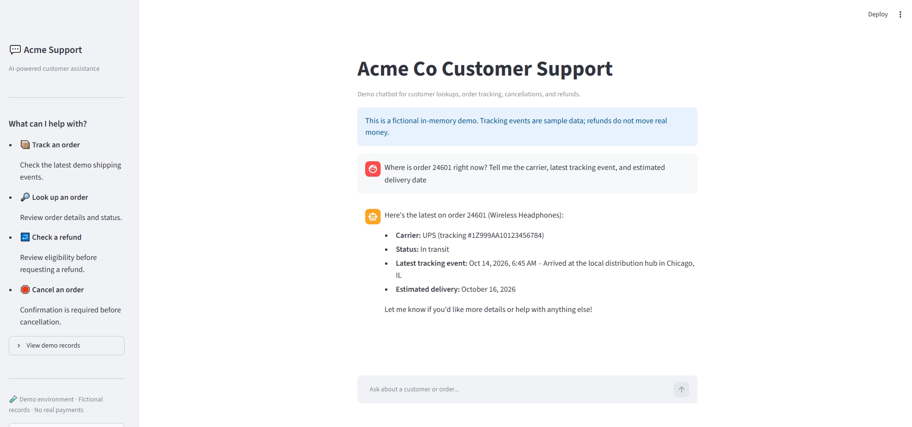
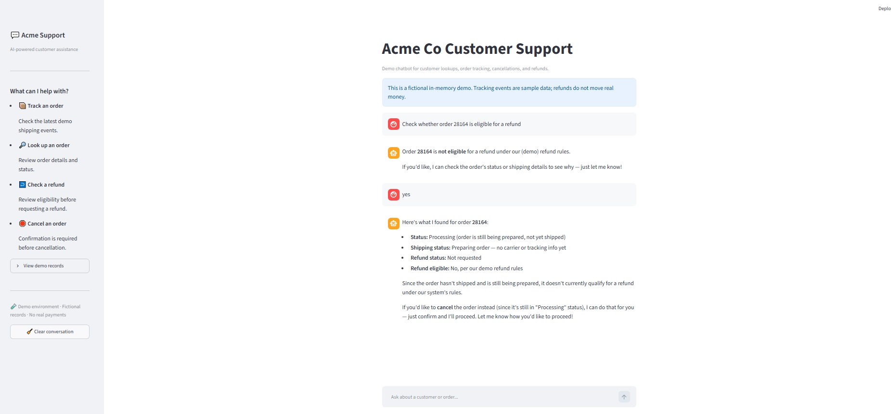
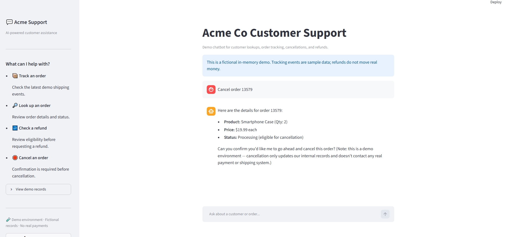

# Building an AI-Powered Customer Support Assistant with Anthropic Claude  

A practical customer-support chatbot built with **Anthropic Claude, Python, and Streamlit**. The application uses Claude's tool-calling capabilities to retrieve customer and order information and execute controlled support operations through a Python backend.

## Overview  

This repository contains the full implementation of the publication **Building an AI-Powered Customer Support Assistant with Anthropic Claude**, published on the **Ready Tensor platform**.  

Customer-support teams frequently handle recurring requests such as:

- Looking up an order.  
- Checking order and shipping status.  
- Retrieving shipment tracking information.  
- Checking refund eligibility.  
- Requesting an order cancellation.  

This project demonstrates how a large language model (LLM) can support these workflows through a conversational interface.

Instead of simply generating answers, the assistant can identify when it needs information from the application and invoke predefined Python tools to retrieve data or perform an operation.

The project uses Anthropic Claude for natural-language understanding and tool selection, Python for the backend logic, and Streamlit for the user interface.

> _Important: This is a demonstration application. Customer, order, and shipping information is simulated. Refund and cancellation operations affect only the demo backend; no real payments, shipments, or customer accounts are modified._

---    

## Who Is This Project For?

This project is intended for:

- Customer support agents
- E-commerce businesses
- Online retailers
- Small and medium-sized businesses (SMBs)
- Customer service managers
- AI developers and students
- Software developers interested in LLMs and tool calling

It provides both a practical example of AI-assisted customer support and a learning resource for developers exploring Anthropic Claude, Python, Streamlit, and API-based tool integration.  

---

## Main Features  

- **Conversational interface**: Interact with the assistant using natural language.  
- **Order lookup**: Retrieve information about demo customer orders.  
- **Shipping information**: Check shipment status and available tracking events.  
- **Refund eligibility**: Check whether an order meets the demo refund conditions.  
- **Order cancellation**: Request cancellation through a controlled backend operation.    
- **Tool calling**: Allow Claude to invoke predefined Python functions when a request requires application data or an action.
- **Confirmation safeguards**: Sensitive operations require explicit user confirmation.  
- **Demo database**: Work with a simulated collection of customers, orders, and shipping events.    

---  

## Technology Stack

| Technology | Purpose |
|---|---|
| Python | Application and backend logic |
| Anthropic Claude API | Language model and tool calling |
| Streamlit | Web-based conversational interface |
| python-dotenv | Loading environment variables |
| Simulated database | Demo customer, order, and shipping data |  

---  

## Project Structure (Repository structure) 

```text
AI_Customer_Support_Assistent_Anthropic/
│
├── Screenshots/          # UI output examples
│   ├── Screenshot_14-10-2026_183433_localhost.jpeg
│   ├── Screenshot_14-10-2026_183833_localhost.jpeg
│   ├── Screenshot_14-10-2026_184035_localhost.jpeg
│   ├── Screenshot_14-10-2026_18413_localhost.jpeg
│   └── Screenshot_14-10-2026_184155_localhost.jpeg
├── .env_example          # Example environment configuration
├── app.py                # Streamlit user interface
├── helper.py
├── requirements.txt      # Python dependencies
├── support_backend.py    # Demo database, tools, and backend logic
├── .gitignore            # Files excluded from Git
├── LICENSE               # Project license
├── README.md             # Project documentation

```

## Available Tools

Based on the actual `support_backend.py` file, there are seven tools defined and implemented. Thus, the customer-support assistant uses seven tools to interact with the simulated customer-support database. These tools allow Claude to retrieve customer and order information, check shipping details, and perform eligible order-management operations.

| Tool | Description | Required Input |
|---|---|---|
| `get_user` | Finds a customer using their email address, phone number, or username. | `key`, `value` |
| `get_order_by_id` | Retrieves the details and current status of a specific order. | `order_id` |
| `get_customer_orders` | Lists all orders associated with a customer. | `customer_id` |
| `cancel_order` | Cancels an order if its status is Processing. | `order_id` |
| `get_shipping_status` | Retrieves the carrier, tracking number, estimated delivery date, shipping status, and tracking events. | `order_id` |
| `check_refund_eligibility` | Checks whether an order qualifies for a refund and calculates the potential refund amount. | `order_id` |
| `issue_refund` | Records a simulated refund after eligibility has been verified and the customer has explicitly confirmed the action. | `order_id` |


> _Note : All seven tools are defined in the tools list and connected to their corresponding Python functions through process_tool_call()_

Each tool is defined through Anthropic's tool-use interface and executed by the Python backend through a dedicated dispatcher. Claude determines when a tool is needed, while the backend validates and executes the requested operation. Sensitive actions, such as cancellations and refunds, are subject to eligibility checks and explicit customer confirmation. All operations use fictional, in-memory data; no real orders or payments are affected.

## How Tool Use Works

Tool use allows Claude to interact with external functions and systems through the Python application. In this project, Claude can request operations such as retrieving customer information, checking order details, tracking shipments, and processing eligible order-management actions.

The tools are defined in `support_backend.py` and passed to Claude through the Anthropic Messages API. Claude determines when a tool is needed and generates a structured request containing the tool name and its input arguments. The Python application receives the request, executes the corresponding function, and sends the result back to Claude.

**Claude does not execute Python functions directly.** The application is responsible for executing the requested operations and controlling access to the simulated database.

### Conceptual Flow

```text
User
  ↓
Streamlit application (app.py)
  ↓
Claude – Anthropic Messages API
  ↓
Structured tool request
  ↓
Python backend (support_backend.py)
  ↓
Tool execution
  ↓
Tool result
  ↓
Claude
  ↓
Final response
  ↓
Streamlit interface
```

### The Tool-Use Message Loop

The application implements an iterative message exchange through the `run_assistant()` function in `app.py`.

The process follows these steps:

1. **User request:** The user submits a message through the Streamlit chat interface.
2. **API request:** The application sends the conversation history, system prompt, and available tool definitions to Claude using `client.messages.create()`.
3. **Claude response:** Claude determines whether it can answer directly or needs to request one or more tools.
4. **Response handling:** The application checks `response.stop_reason` to determine what to do next.
5. **Tool execution:** If Claude requests tools, the application processes each `tool_use` block and calls `process_tool_call()` from `support_backend.py`.
6. **Tool results:** The application collects the results and sends them back to Claude in a new message.
7. **Final response:** Claude processes the returned results and either requests additional tools or produces its final response.

The application uses the following `stop_reason` values:

| `stop_reason` | Meaning |
|---|---|
| `tool_use` | Claude is requesting one or more tools. |
| `end_turn` | Claude has completed its response. |
| Other values | The application raises an error because the response is not handled by the current implementation. |

### Example: Processing a Tool Request

For example, when a customer asks to look up their account using an email address, Claude may request the `get_user` tool.

The request is represented by a `tool_use` content block. The application accesses its attributes directly:

```python
block.name   # "get_user"
block.input  # {"key": "email", "value": "john@gmail.com"}
block.id     # Identifier for this tool request
```

The application passes the tool name and input arguments to the backend dispatcher:

```python
result = process_tool_call(block.name, block.input)
```

In `support_backend.py`, the `process_tool_call()` function maps the requested tool name to the corresponding Python method:

```python
dispatch = {
    "get_user": db.get_user,
    "get_order_by_id": db.get_order_by_id,
    "get_customer_orders": db.get_customer_orders,
    "cancel_order": db.cancel_order,
    "get_shipping_status": db.get_shipping_status,
    "check_refund_eligibility": db.check_refund_eligibility,
    "issue_refund": db.issue_refund,
}

return dispatch[tool_name](**tool_input)
```

The backend executes the selected method against the simulated database and returns its result.

### Returning Tool Results to Claude

After executing the requested tools, the application converts each result into JSON and creates a `tool_result` content block:

```python
result_text = json.dumps(result, ensure_ascii=False, default=str)

tool_results.append({
    "type": "tool_result",
    "tool_use_id": block.id,
    "content": result_text,
})
```

The `tool_use_id` associates the result with the original tool request.

The application then appends all collected tool results to the conversation as a user message:

```python
messages.append({
    "role": "user",
    "content": tool_results
})
```

If a tool execution raises an exception, the application also returns an error result with `is_error=True`, allowing the tool failure to be reported to Claude.

The `while True` loop in `run_assistant()` then calls Claude again with the updated conversation. This process continues until Claude returns `end_turn`, at which point the application extracts the text response and displays it in Streamlit.

**Key principle:** Tool use is an iterative message exchange. Claude decides which tools to request, the Python backend executes them, and the results are returned to Claude so it can generate an informed response.

---
## Installation (Getting started)  

This section shows how to install dependencies, configure authentication, and run the full pipeline.

### Prerequisites:

- Python 3.10+    
- Anthropic Clauude API key    

### 1. Clone the repository

```bash
git clone https://github.com/micag2025/AI_Customer_Support_Assitent_Anthropic.git
cd AI_Customer_Support_Assitent_Anthropic
```

### 2. Create a virtual environment

On Windows:

```bash
py -m venv .venv
.venv\Scripts\activate
```

On macOS or Linux:

```bash
python3 -m venv .venv
source .venv/bin/activate
```

### 3. Install dependencies

```bash
python -m pip install streamlit anthropic python-dotenv
```

### 4. Configure the Anthropic API key

Create a `.env` file in the project root:

```env
ANTHROPIC_API_KEY=your_actual_anthropic_api_key
```

Here the model 'claude-sonnet-5' has been selected and used. If the backend requires another configurable `model name`, also add the corresponding model setting used by `support_backend.py`. 

---  

## Running the Application

From the project directory, execute:

```bash
python -m streamlit run app.py
```

Streamlit will start the application and provide a local URL, normally:

```text
http://localhost:8501
```

Open that address in your browser to interact with the customer-support assistant.  

## Stop the application  

```bash
Ctrl+C
```
Press it in the terminal where Streamlit is running.

---  

## Example Use Cases (UI Walkthrough & Example Runs)  

### Web UI  

The application features a clean, dark-themed interface built with Streamlit. The sidebar provides an overview of the available `customer-support functions`, including `order tracking`, `order lookup`, `refund eligibility checks`, and `order cancellations`. It also includes access to fictional demo records and a button to clear the conversation. The main area displays the application title, a notice explaining the simulated environment, and a `chat input where users can submit questions or requests`. This simple layout makes the assistant easy to navigate and interact with while demonstrating its main customer-support capabilities.


---  

Once the application is running, you can try requests such as:

### Order lookup

> Can you check the details of order 24601?

    

---

> QUERY TO BE ENCLOSED

    

---  

### Shipping information

> What is the shipping status of order 13579?

SCREENSHOT TO BE ENCLOSED   

---  

### Refund eligibility

> Can you check whether order 97531 is eligible for a refund?

    

---  

### Order cancellation  

> I would like to cancel order 28164. Can you check whether that is possible?



The actual outcome depends on the demo records and the business rules implemented in the backend.  

---

## How It Works

The application separates the conversational layer from the business logic.

1. The user enters a request through the Streamlit chat interface.
2. The application sends the conversation and available tool definitions to Anthropic Claude.
3. Claude interprets the request and determines whether one of the available tools is needed.
4. If a tool is requested, the Python backend executes the corresponding function.
5. The tool result is returned to Claude.
6. Claude uses the result to formulate a response for the user.
7. For sensitive operations, the application follows its confirmation and eligibility checks before executing the action.

This architecture illustrates how an LLM can interact with application functionality without directly accessing or modifying the underlying database.  

## Architecture structure   

The following diagram illustrates the main communication flow:  


        ┌──────────────────────────┐
        │       User               │
        │  Asks a support question │
        └────────────┬─────────────┘
                     │
                     ▼
        ┌──────────────────────────┐
        │      Streamlit UI        │
        │  Receives user request   │
        └────────────┬─────────────┘
                     │
               Send request
                     │
                     ▼
        ┌──────────────────────────┐
        │     Anthropic Claude     │
        │ Understands the request  │
        │ Selects the required tool│
        └────────────┬─────────────┘
                     │
                Tool request
                     │
                     ▼
        ┌──────────────────────────┐
        │      Python Backend      │
        │   Executes the tool      │
        │   Applies business rules │
        └────────────┬─────────────┘
                     │
                Read / Update
                     │
                     ▼
        ┌──────────────────────────┐
        │    Simulated Database    │
        │   Customers              │
        │   Orders                 │
        │   Shipping Events        │
        └────────────┬─────────────┘
                     │
                Return data
                     │
                     ▼
        ┌──────────────────────────┐
        │      Python Backend      │
        │   Returns tool result    │
        └────────────┬─────────────┘
                     │
                Tool result
                     ▼
        ┌──────────────────────────┐
        │     Anthropic Claude     │
        │  Generates final answer  │
        └────────────┬─────────────┘
                     │
                Final response
                     ▼
        ┌──────────────────────────┐
        │       Streamlit UI       │
        │   Displays response      │
        └──────────────────────────┘


*Figure 1 — Simplified system architecture showing how a user request travels through Streamlit, Anthropic Claude, the Python backend, and the simulated database before the final response is returned to the user. (Logical architecture and communication flow of the customer-support assistant.)*  

---  

## Safety and Limitations

This repository is intended for learning and experimentation.

- The database contains fictional demonstration records.
- Order and shipping information is not retrieved from real external services.
- Refund and cancellation operations are simulated.
- No real payment processor or logistics provider is connected.
- The application should not be used to handle real customer information or transactions without additional security and operational controls.

A production implementation would require persistent data storage, user authentication, authorization, secure API integrations, audit logging, error handling, and appropriate privacy controls.  

---  

## Possible Future Improvements

The project provides a starting point for further development. Potential extensions include:

- Replacing the simulated database with a persistent database.
- Integrating real shipping and tracking APIs.
- Connecting to a payment provider in a controlled test environment.
- Adding authentication and role-based authorization.
- Introducing audit logs for sensitive operations.
- Adding automated tests for backend functions and tool execution.
- Improving observability, error handling, and conversation management.
- Exploring more advanced agent workflows.

---  

## Contributing  

Contributions are welcomed to improve the Anthropic Claude Customer Support Assistant. The suggested workflow is the following:    

- Fork the GitHub repository  
- Create a feature branch:
  
```bash  
git checkout -b feat/your-feature
```
- Commit and push your changes  
- Submit a Pull Request and describe your contribution.  

>_Note : Please follow the repository code style and add tests for major features._

---  

## References  

- [Claude Platform Docs](https://platform.claude.com/docs/en/home)    
- [Anthropic](https://www.anthropic.com/)
- [Steamlit](https://docs.streamlit.io/) 
- [Technical Evaluation Rubric](https://app.readytensor.ai/publications/technical-excellence-in-aiml-and-data-science-publications-an-evaluation-rubric-WsaE5uxLBqnH)  
- [Engage and Inspire: Best Practices for Publishing on Ready Tensor](https://app.readytensor.ai/publications/engage-and-inspire-best-practices-for-publishing-on-ready-tensor-SBgkOyUsP8qQ)
- [The Open Source Repository Guide: Best Practices for Sharing Your AI/ML and Data Science Projects](https://app.readytensor.ai/publications/best-practices-for-ai-project-code-repositories-0llldKKtn8Xb)
- [Markdown for Machine Learning Projects: A Comprehensive Guide](https://app.readytensor.ai/publications/markdown-for-machine-learning-projects-a-comprehensive-guide-LX9cbIx7mQs9)  

---

## License
This project is licensed under the [MIT License](/LICENSE).  

---  

## Contact
If you encounter bugs, have questions, or want to request a new feature, please open an issue on this repository.

---  

## Acknowledgements  

TO BE DRAFTED  

---


