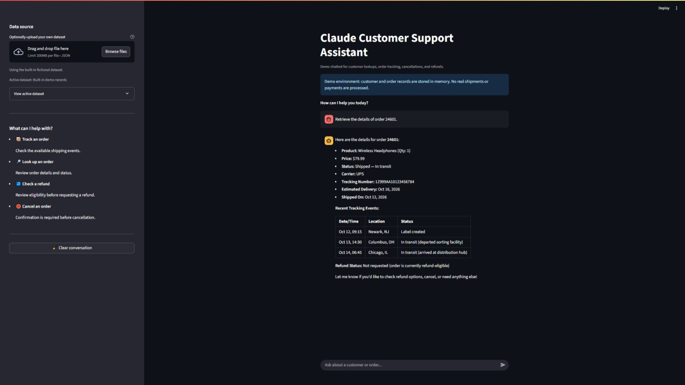
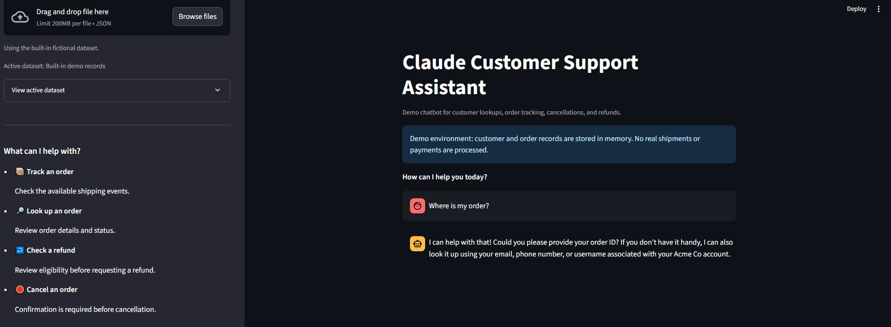
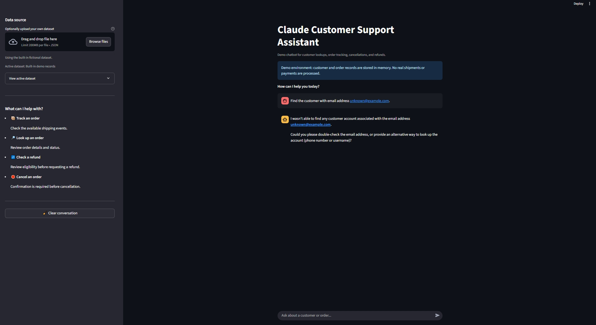
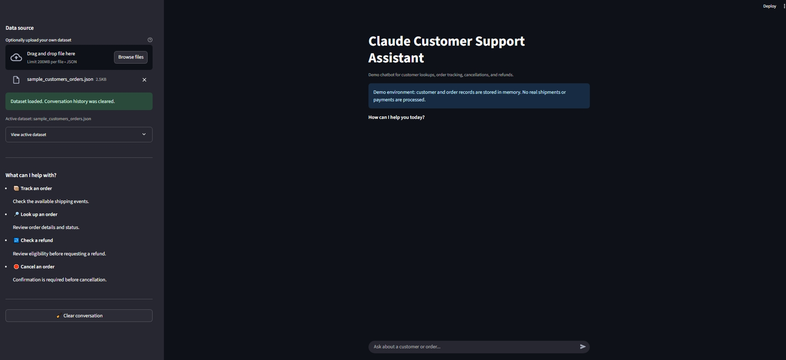
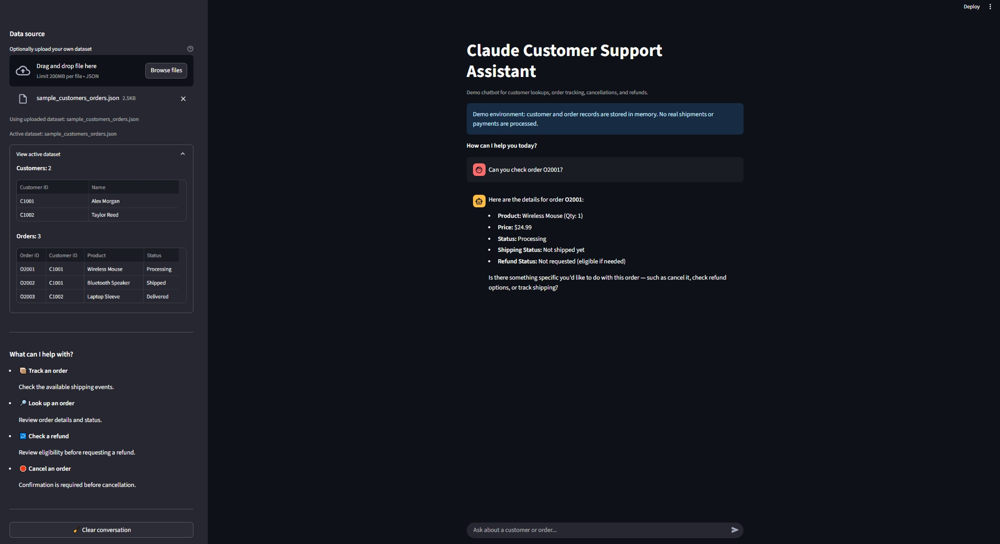

# AI-Powered Customer Support Assistant with Anthropic Claude

A practical customer-support chatbot built with **Anthropic Claude, Python, and Streamlit**. The application uses Claude's tool-calling capabilities to retrieve customer and order information and execute controlled support operations through a Python backend.

## Overview  

This repository contains the full implementation of the publication **Building an AI-Powered Customer Support Assistant with Anthropic Claude**, published on the **Ready Tensor platform**.  

Customer-support teams frequently handle recurring requests such as:

- Looking up an order.  
- Checking order and shipping status.  
- Retrieving shipment tracking information.  
- Checking refund eligibility.  
- Requesting an order cancellation.  

This project demonstrates how a large language model (LLM) can support these workflows through a conversational interface.

Instead of simply generating answers, the assistant can identify when it needs information from the application and invoke predefined Python tools to retrieve data or perform an operation.

The project uses Anthropic Claude for natural-language understanding and tool selection, Python for the backend logic, and Streamlit for the user interface.

> _Important: This is a demonstration application. Customer, order, and shipping information is simulated. Refund and cancellation operations affect only the demo backend; no real payments, shipments, or customer accounts are modified._

---    

## Who Is This Project For?

This project is intended for:

- Customer support agents
- E-commerce businesses
- Online retailers
- Small and medium-sized businesses (SMBs)
- Customer service managers
- AI developers and students
- Software developers interested in LLMs and tool calling

It provides both a practical example of AI-assisted customer support and a learning resource for developers exploring Anthropic Claude, Python, Streamlit, and API-based tool integration.  

---

## Main Features  

- **Conversational interface**: Interact with the assistant using natural language.  
- **Order lookup**: Retrieve information about demo customer orders.  
- **Shipping information**: Check shipment status and available tracking events.  
- **Refund eligibility**: Check whether an order meets the demo refund conditions.  
- **Order cancellation**: Request cancellation through a controlled backend operation.    
- **Tool calling**: Allow Claude to invoke predefined Python functions when a request requires application data or an action.
- **Confirmation safeguards**: Sensitive operations require explicit user confirmation.  
- **Demo database**: Work with a simulated collection of customers, orders, and shipping events.    

---  

## Technology Stack

| Technology | Purpose |
|---|---|
| Python | Application and backend logic |
| Anthropic Claude API | Language model and tool calling |
| Streamlit | Web-based conversational interface |
| python-dotenv | Loading environment variables |
| Simulated database | Demo customer, order, and shipping data |  

---  

## Repository Structure

```text
AI_Customer_Support_Assistent_Anthropic/
│
├── Screenshots/          # Application screenshots for documentation.
│   ├── Screenshot_Interface.jpeg
│   ├── Screenshot_Customer_Lookup.jpeg
│   ├── Screenshot_Order_Information.jpeg
│   ├── Screenshot_Shipping_Tracking.jpeg
│   ├── Screenshot_Order_Cancellation.jpeg
│   ├── Screenshot_Refund_Eligibility.jpeg
│   ├── Screenshot_Unknown_customer.jpeg
│   ├── Screenshot_Missing_required_information.jpeg
│   ├── Screenshot_Interface_uploaded_dataset.jpeg
│   └── Screenshot_Order_Lookup_uploaded_dataset.jpeg
├── .env_example              # Example environment configuration
├── app.py                    # Streamlit interface, dataset upload, session management and chat interaction.
├── helper.py                 # Utility functions for loading environment variables and retrieving the Anthropic API key
├── support_backend.py        # Claude integration, seven tools, database operations and dataset validation/loading
├── sample_customers_orders.json    # Example dataset for testing custom uploads.
├── requirements.txt          # Python dependencies
├── .gitignore                # Files excluded from Git
├── LICENSE                   # Project license
├── README.md                 # Installation, configuration, usage and dataset documentation.

```

## Dataset Overview

The application supports both a **built-in fictional demonstration dataset** and **optional user-provided datasets in JSON format**.  

By default, the project uses a fictional, in-memory customer support dataset embedded directly in `support_backend.py`. It includes:

- 10 customer records
- 12 order records
- Customer details such as IDs, names, email addresses, phone numbers, and usernames
- Order details such as order ID, product, quantity, price, and status
- Shipping details such as carrier, tracking number, estimated delivery date, and tracking events
- Refund information, including eligibility and potential refund amounts

Users can also upload their own JSON datasets using the application's dataset upload feature. The repository includes `sample_customers_orders.json` as an example of the expected data structure. This allows users to experiment with different customer and order records without modifying the built-in demonstration data.

Both data sources support workflows such as customer lookup, order management, shipment tracking, refund eligibility checks, and cancellations.

> **Note:** All built-in demonstration records and sample records are fictional. Data is maintained in memory during application execution. Changes are not persisted after the application restarts, and no real financial or logistics systems are connected.

---  

## Available Tools

Based on the actual `support_backend.py` file, there are seven tools defined and implemented. Thus, the customer-support assistant uses seven tools to interact with the simulated customer-support database. These tools allow Claude to retrieve customer and order information, check shipping details, and perform eligible order-management operations.

| Tool | Description | Required Input |
|---|---|---|
| `get_user` | Finds a customer using their email address, phone number, or username. | `key`, `value` |
| `get_order_by_id` | Retrieves the details and current status of a specific order. | `order_id` |
| `get_customer_orders` | Lists all orders associated with a customer. | `customer_id` |
| `cancel_order` | Cancels an order if its status is Processing. | `order_id` |
| `get_shipping_status` | Retrieves the carrier, tracking number, estimated delivery date, shipping status, and tracking events. | `order_id` |
| `check_refund_eligibility` | Checks whether an order qualifies for a refund and calculates the potential refund amount. | `order_id` |
| `issue_refund` | Records a simulated refund after eligibility has been verified and the customer has explicitly confirmed the action. | `order_id` |

Each tool is defined through Anthropic's tool-use interface and executed by the Python backend through a dedicated dispatcher, `process_tool_call()`. Claude determines when a tool is needed and generates the corresponding structured tool request, while the backend executes the requested operation against the active dataset. Operations such as order cancellations and refunds are subject to business-rule and eligibility checks. Explicit customer confirmation is requested through the conversation before these actions are performed. All operations use fictional, in-memory data; no real orders, shipments, or payments are affected.

---

## How Tool Use Works

Tool use allows Claude to interact with external functions and systems through the Python application. In this project, Claude can request operations such as retrieving customer information, checking order details, tracking shipments, and processing eligible order-management actions.

The tools are defined in `support_backend.py` and passed to Claude via the Anthropic Messages API. Claude decides when a tool is needed and returns a structured request containing the tool name and arguments.

### Important Principle

Claude does not execute Python functions directly. The application is responsible for executing the requested operations and controlling access to the demo database.  

### Conceptual Flow

```text
User
  ↓
Streamlit application (app.py)
  ↓
Claude (Anthropic Messages API)
  ↓
Structured tool request
  ↓
Python backend (support_backend.py)
  ↓
Tool execution
  ↓
Tool result
  ↓
Claude
  ↓
Final response
  ↓
Streamlit interface
```

The user interacts with the assistant through the Streamlit interface. Claude interprets the request and determines whether one or more predefined tools are needed. When a tool is required, Claude returns a structured tool request. The Python backend executes the corresponding function and returns the result to Claude, which generates a natural-language response displayed in the Streamlit interface.

### The Tool-Use Message Loop

The application implements an iterative message exchange through the `run_assistant()` function in `app.py`.

The process follows these steps:

1. **User request:** The user submits a message through the Streamlit chat interface.
2. **API request:** The application sends the conversation history, system prompt, and available tool definitions to Claude using `client.messages.create()`.
3. **Claude response:** Claude determines whether it can answer directly or needs to request one or more tools.
4. **Response handling:** The application checks `response.stop_reason` to determine what to do next.
5. **Tool execution:** If Claude requests tools, the application processes each `tool_use` block and calls `process_tool_call()` from `support_backend.py`.
6. **Tool results:** The application collects the results and sends them back to Claude in a new message.
7. **Final response:** Claude processes the returned results and either requests additional tools or produces its final response.

The application supports the following `stop_reason` values:  

| `stop_reason` | Meaning |
|---|---|
| `tool_use` | Claude is requesting one or more tools. |
| `end_turn` | Claude has completed its response. |
| Other values | The application raises an error because the response is not handled by the current implementation. |

### Example: Processing a Tool Request

For example, when a customer asks to look up their account using an email address, Claude may request the `get_user` tool.

The request is represented by a `tool_use` content block. The application accesses its attributes directly:

```python
block.name   # "get_user"
block.input  # {"key": "email", "value": "john@gmail.com"}
block.id     # Identifier for this tool request
```

The application passes the tool name and input arguments to the backend dispatcher:

```python
result = process_tool_call(block.name, block.input)
```

In `support_backend.py`, the `process_tool_call()` function maps the requested tool name to the corresponding Python method:

```python
dispatch = {
    "get_user": db.get_user,
    "get_order_by_id": db.get_order_by_id,
    "get_customer_orders": db.get_customer_orders,
    "cancel_order": db.cancel_order,
    "get_shipping_status": db.get_shipping_status,
    "check_refund_eligibility": db.check_refund_eligibility,
    "issue_refund": db.issue_refund,
}

return dispatch[tool_name](**tool_input)
```

The backend executes the selected method against the simulated database and returns its result.

### Returning Tool Results to Claude

After executing the requested tools, the application converts each result into JSON and creates a `tool_result` content block:

```python
result_text = json.dumps(result, ensure_ascii=False, default=str)

tool_results.append({
    "type": "tool_result",
    "tool_use_id": block.id,
    "content": result_text,
})
```

The `tool_use_id` associates the result with the original tool request.

The application then appends all collected tool results to the conversation as a user message:

```python
messages.append({
    "role": "user",
    "content": tool_results
})
```

If a tool execution raises an exception, the application also returns an error result with `is_error=True`, allowing the tool failure to be reported to Claude.

The `while True` loop in `run_assistant()` then calls Claude again with the updated conversation. This process continues until Claude returns `end_turn`, at which point the application extracts the text response and displays it in Streamlit.

**Key principle:** Tool use is an iterative message exchange. Claude decides which tools to request, the Python backend executes them, and the results are returned to Claude so it can generate an informed response.    

---

## Streamlit Application 

The `app.py` file is the main application entry point. It:  

- Builds the Streamlit interface  
- Manages chat interaction between the user and Claude  
- Handles tool calls and result processing    
- Displays final responses in the app  

---  

## Installation and Setup

### Prerequisites:

- Python 3.10+    
- Anthropic API key  
- Git    

### Clone the Repository

```bash
git clone https://github.com/micag2025/AI_Customer_Support_Assistant_Anthropic.git
cd AI_Customer_Support_Assistant_Anthropic  
```

### Create a Virtual Environment

On Windows:

```bash
py -m venv .venv
.venv\Scripts\activate
```

On macOS or Linux:

```bash
python3 -m venv .venv
source .venv/bin/activate
```

### Install Dependencies

```bash
python -m pip install -r requirements.txt
```

### Configure the Anthropic API key

Create a `.env` file in the project root:

```env
ANTHROPIC_API_KEY=your_actual_anthropic_api_key
```

This project uses the model `claude-sonnet-5`. If your backend configuration requires a different model name, update the corresponding setting in `support_backend.py`.  

---  

## Running the Application

From the project directory, execute:

```bash
python -m streamlit run app.py
```

Streamlit will start the app and provide a local URL, such as:  

```text
http://localhost:8501
```

Open that URL in your browser to interact with the customer support assistant.  

To stop the app, press:  

```bash
Ctrl+C
```
---    

## How It Works (TO BE REMOVED?)  

The application separates the conversational layer from the business logic.

1. The user enters a request through the Streamlit chat interface.
2. The application sends the conversation and available tool definitions to Anthropic Claude.
3. Claude interprets the request and determines whether one of the available tools is needed.
4. If a tool is requested, the Python backend executes the corresponding function.
5. The tool result is returned to Claude.
6. Claude uses the result to formulate a response for the user.
7. For sensitive operations, the application follows its confirmation and eligibility checks before executing the action.

---

## Example Queries for Testing

The following examples can be used to test the Streamlit customer-support assistant and explore its main functionality. They cover **successful interactions** as well as **scenarios involving invalid inputs, missing information, and business-rule restrictions**.    

| Category | Example Query | Expected Behavior |
|---|---|---|
| Customer Lookup | “Find the customer with email address john@gmail.com.” | The assistant identifies the matching customer and returns the relevant profile. |
| Customer Lookup (Follow-up) | “Show me all orders associated with this customer.” | Using the customer identified in the previous interaction, the assistant retrieves and displays their order history.|
| Order Information | “Retrieve the details of order 24601.” | The assistant returns the order summary and current status. |
| Order Information | “What is the current status of order 13579?” | The assistant checks the order record and reports its current status. |
| Shipping and Tracking | “Where is my order 24601, and when is it expected to arrive?” | The assistant retrieves shipping information and the estimated delivery date. |
| Shipping and Tracking | “Provide the latest tracking updates for order 54321.” | The assistant shows the available tracking events and latest shipment status. |
| Shipping and Tracking | “Has order 86420 been delivered?” | The assistant confirms whether the order has been delivered. |
| Order Cancellation | “I would like to cancel order 13579. Is that possible?” | The assistant checks whether the order is eligible for cancellation and requests confirmation if required. |
| Order Cancellation | “Can order 97531 still be cancelled?” | The assistant determines whether the order is still in a cancellable state. |
| Refund Eligibility | “Am I eligible for a refund for order 86420?” | The assistant checks refund eligibility and explains the result. |
| Refund Eligibility | “Why is order 54321 not eligible for a refund?” | The assistant explains the relevant business rule that prevents the refund. |
| Refund Eligibility | “I would like to request a refund for order 86420. Can you check its eligibility?” | The assistant verifies eligibility and requests explicit customer confirmation before proceeding.[1] |
| Unknown Customer | “Find the customer with email address unknown@example.com.” | The assistant reports that no matching customer was found. |
| Unknown Order | “Retrieve the details of order 99999.” | The assistant explains that the order could not be found. |
| Invalid Order ID | “Check the shipping status of order ABC-XYZ.” | The assistant reports that no matching order was found and asks the user to verify the order ID. |
| Cancellation of an Already Shipped Order | “I would like to cancel order 24601. Can you do that?” | The backend rejects the cancellation because the order has already shipped. |
| Missing Required Information | “Where is my order?” | The assistant asks the user to provide an order ID before retrieving shipping information. |

**[1] Refund processing:** An eligibility check and explicit customer confirmation are required before a refund is recorded. Refunds are simulated in the database; no actual payment is processed.

These examples demonstrate how the assistant interprets natural-language requests, selects and invokes the appropriate tools, retrieves or updates information, and handles unsuccessful operations. The actual outcome depends on the demo records and the business rules implemented in the backend.

---  

## Example Use Cases 

### Web UI    

The application includes a Streamlit interface. The sidebar provides an overview of available customer support functions, including order tracking, order lookup, cancellations, and refund checks. It also includes  a button to clear the conversation. The main area displays a chat input where users can submit questions or requests.     

  

---  

### Order Lookup  

Customer Lookup screen of the AI Customer Support Assistant, demonstrating how customer data is retrieved and presented in a simple, user-friendly interface to support faster, more informed assistance.

    

---

### Order Information  

Order Information screen showing the customer’s order summary, including status, items, and shipping details, helping the assistant provide clear and timely support.

    

---  

### Shipping and Tracking Information    

This screenshot shows how the assistant retrieves and presents the simulated shipment status, tracking number, estimated delivery date, and available tracking events.


    

---  

### Order Cancellation    

This screenshot demonstrates the cancellation workflow, including the eligibility checks and confirmation safeguards implemented in the backend.

    

---  

### Refund Eligibility and Processing

This screenshot illustrates how the assistant checks refund eligibility against the application's business rules and explains the result to the user.


   

---  

### Missing Required Information  

Example of the assistant’s required-field validation: the user is prompted to provide missing information before the request can proceed.  

    

---  

### Unknown Customer    

This screenshot shows the AI Customer Support Assistant interface handling an unidentified customer inquiry, highlighting the conversational support workflow and the assistant’s ability to respond to customer needs in real time.  

   


The actual outcome depends on the demo records and the business rules implemented in the backend.  

---

### Working with a User-Provided Dataset

In addition to the built-in demonstration records, the application supports uploading custom customer and order datasets in JSON format. The following screenshots illustrate the selection of the sample dataset and a subsequent order lookup using the uploaded records.

**Loading a user-provided dataset**



**Retrieving order information from the uploaded dataset**



---

## Safety and Limitations

This project is intended for learning and experimentation.

- The database contains fictional demo records.
- Order and shipping information is not retrieved from real external services.
- Refund and cancellation operations are simulated.
- No real payment processor or logistics provider is connected.
- Customer lookup is currently supported by email address, phone number, or username. Lookup by customer name has not been implemented; when only a name is provided, the assistant requests an additional identifier to avoid selecting the wrong customer.
- The application should not be used to process real customer information or transactions without additional security and operational controls.

A production implementation would require persistent data storage, user authentication, authorization, secure API integrations, audit logging, error handling, and stronger privacy safeguards.  

---  

## Possible Future Improvements

Potential improvements include:

- Replacing the simulated database with a persistent database.
- Integrating real shipping and tracking APIs.
- Connecting to a payment provider in a controlled test environment.
- Adding authentication and role-based authorization.
- Introducing audit logs for sensitive operations.
- Adding customer name lookup with ambiguity handling, allowing the assistant to request additional identifiers when multiple customers have the same name.
- Adding automated tests for backend functions and tool execution.
- Improving observability, error handling, and conversation management.
- Exploring more advanced agent workflows.

---  

## Contributing    

Contributions are welcome to improve the Anthropic Claude Customer Support Assistant.

Suggested workflow:

1. Fork the repository
2. Create a feature branch:

```bash
git checkout -b feat/your-feature
```

3. Commit and push your changes
4. Open a pull request and describe your contribution

> Please follow the repository’s code style and add tests for major features.

---  

## References    

- [Claude Platform Documentation](https://platform.claude.com/docs/en/home)
- [Anthropic](https://www.anthropic.com/)
- [Streamlit Documentation](https://docs.streamlit.io/)
- [Technical Evaluation Rubric](https://app.readytensor.ai/publications/technical-excellence-in-aiml-and-data-science-publications-an-evaluation-rubric-WsaE5uxLBqnH)
- [Engage and Inspire: Best Practices for Publishing on Ready Tensor](https://app.readytensor.ai/publications/engage-and-inspire-best-practices-for-publishing-on-ready-tensor-SBgkOyUsP8qQ)
- [The Open Source Repository Guide](https://app.readytensor.ai/publications/best-practices-for-ai-project-code-repositories-0llldKKtn8Xb)
- [Markdown for Machine Learning Projects: A Comprehensive Guide](https://app.readytensor.ai/publications/markdown-for-machine-learning-projects-a-comprehensive-guide-LX9cbIx7mQs9)  

---

## License  

This project is licensed under the [MIT License](/LICENSE).  

---  

## Contact    

If you encounter bugs, have questions, or want to request a new feature, please open an [issue](https://github.com/micag2025/AI_Customer_Support_Assitent_Anthropic/issues/) on this repository.

---  

## Acknowledgements  

Acknowledgements to the Ready Tensor developer community for creating a vibrant ecosystem where AI professionals can share projects, insights, and innovations, helping accelerate the advancement of AI technology.    

---


