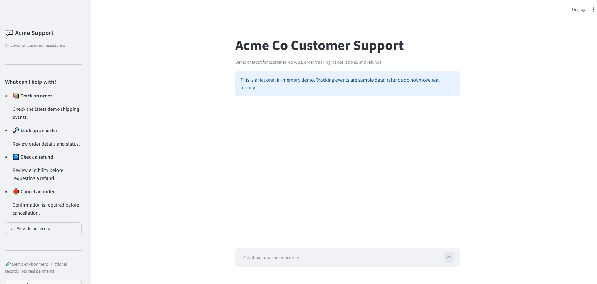

# Building an AI-Powered Customer Support Assistant with Anthropic Claude  

A practical customer-support chatbot built with **Anthropic Claude, Python, and Streamlit**. The application uses Claude's tool-calling capabilities to retrieve customer and order information and execute controlled support operations through a Python backend.

## Overview  

This repository contains the full implementation of the publication **Building an AI-Powered Customer Support Assistant with Anthropic Claude**, published on the **Ready Tensor platform**.  A companion publication on the **Ready Tensor platform** presents the motivation, architecture, implementation, and lessons learned while developing this application.

Customer-support teams frequently handle recurring requests such as:

- Looking up an order.  
- Checking order and shipping status.  
- Retrieving shipment tracking information.  
- Checking refund eligibility.  
- Requesting an order cancellation.  

This project demonstrates how a large language model (LLM) can support these workflows through a conversational interface.

Instead of simply generating answers, the assistant can identify when it needs information from the application and invoke predefined Python tools to retrieve data or perform an operation.

The project uses Anthropic Claude for natural-language understanding and tool selection, Python for the backend logic, and Streamlit for the user interface.

> _Important: This is a demonstration application. Customer, order, and shipping information is simulated. Refund and cancellation operations affect only the demo backend; no real payments, shipments, or customer accounts are modified._

---  

## Main Features  

- **Conversational interface**: Interact with the assistant using natural language.  
- **Order lookup**: Retrieve information about demo customer orders.  
- **Shipping information**: Check shipment status and available tracking events.  
- **Refund eligibility**: Check whether an order meets the demo refund conditions.  
- **Order cancellation**: Request cancellation through a controlled backend operation.    
- **Tool calling**: Allow Claude to invoke predefined Python functions when a request requires application data or an action.
- **Confirmation safeguards**: Sensitive operations require explicit user confirmation.  
- **Demo database**: Work with a simulated collection of customers, orders, and shipping events.    

---  

## Technology Stack

| Technology | Purpose |
|---|---|
| Python | Application and backend logic |
| Anthropic Claude API | Language model and tool calling |
| Streamlit | Web-based conversational interface |
| python-dotenv | Loading environment variables |
| Simulated database | Demo customer, order, and shipping data |  

---  

## Project Structure (Repository structure) 

```text
AI_Customer_Support_Assistent_Anthropic/
│
├── Screenshots/          # UI output examples
│   ├── Screenshot_14-10-2026_183433_localhost.jpeg
│   ├── Screenshot_14-10-2026_183833_localhost.jpeg
│   ├── Screenshot_14-10-2026_184035_localhost.jpeg
│   ├── Screenshot_14-10-2026_18413_localhost.jpeg
│   └── Screenshot_14-10-2026_184155_localhost.jpeg
├── .env_example          # Example environment configuration
├── app.py                # Streamlit user interface
├── helper.py
├── requirements.txt      # Python dependencies
├── support_backend.py    # Demo database, tools, and backend logic
├── .gitignore            # Files excluded from Git
├── LICENSE               # Project license
├── README.md             # Project documentation

```

## Installation (Getting started)  

This section shows how to install dependencies, configure authentication, and run the full pipeline.

### Prerequisites:

Python 3.10+  
Anthropic Clauude API key  

### 1. Clone the repository

```bash
git clone https://github.com/micag2025/AI_Customer_Support_Assitent_Anthropic.git
cd AI_Customer_Support_Assitent_Anthropic
```

> _Note: Replace the example URL and folder name with your repository details._

### 2. Create a virtual environment

On Windows:

```bash
py -m venv .venv
.venv\Scripts\activate
```

On macOS or Linux:

```bash
python3 -m venv .venv
source .venv/bin/activate
```

### 3. Install dependencies

```bash
python -m pip install streamlit anthropic python-dotenv
```

### 4. Configure the Anthropic API key

Create a `.env` file in the project root:

```env
ANTHROPIC_API_KEY=your_actual_anthropic_api_key
```

If the backend requires a configurable model name, also add the corresponding model setting used by `support_backend.py`.

---  

## Running the Application

From the project directory, execute:

```bash
python -m streamlit run app.py
```

Streamlit will start the application and provide a local URL, normally:

```text
http://localhost:8501
```

Open that address in your browser to interact with the customer-support assistant.  

## Stop the application  

```bash
pkill -f TO BE VERIFIED
```
---  

## Example Use Cases (UI Walkthrough & Example Runs)  

**Web UI**   



---  

Once the application is running, you can try requests such as:

**Order lookup**

> Can you check the details of order 24601?

    

---

> QUERY TO BE ENCLOSED

    

---  

**Shipping information**

> What is the shipping status of order 13579?

SCREENSHOT TO BE ENCLOSED   

---  

**Refund eligibility**

> Can you check whether order 97531 is eligible for a refund?

    

---  

**Order cancellation**

> I would like to cancel order 28164. Can you check whether that is possible?


The actual outcome depends on the demo records and the business rules implemented in the backend.  

---

## How It Works

The application separates the conversational layer from the business logic.

1. The user enters a request through the Streamlit chat interface.
2. The application sends the conversation and available tool definitions to Anthropic Claude.
3. Claude interprets the request and determines whether one of the available tools is needed.
4. If a tool is requested, the Python backend executes the corresponding function.
5. The tool result is returned to Claude.
6. Claude uses the result to formulate a response for the user.
7. For sensitive operations, the application follows its confirmation and eligibility checks before executing the action.

This architecture illustrates how an LLM can interact with application functionality without directly accessing or modifying the underlying database.  

## Architecture structure   

The following diagram illustrates the main communication flow:  


        ┌──────────────────────────┐
        │       User               │
        │  Asks a support question │
        └────────────┬─────────────┘
                     │
                     ▼
        ┌──────────────────────────┐
        │      Streamlit UI        │
        │  Receives user request   │
        └────────────┬─────────────┘
                     │
               Send request
                     │
                     ▼
        ┌──────────────────────────┐
        │     Anthropic Claude     │
        │ Understands the request  │
        │ Selects the required tool│
        └────────────┬─────────────┘
                     │
                Tool request
                     │
                     ▼
        ┌──────────────────────────┐
        │      Python Backend      │
        │   Executes the tool      │
        │   Applies business rules │
        └────────────┬─────────────┘
                     │
                Read / Update
                     │
                     ▼
        ┌──────────────────────────┐
        │    Simulated Database    │
        │   Customers              │
        │   Orders                 │
        │   Shipping Events        │
        └────────────┬─────────────┘
                     │
                Return data
                     │
                     ▼
        ┌──────────────────────────┐
        │      Python Backend      │
        │   Returns tool result    │
        └────────────┬─────────────┘
                     │
                Tool result
                     ▼
        ┌──────────────────────────┐
        │     Anthropic Claude     │
        │  Generates final answer  │
        └────────────┬─────────────┘
                     │
                Final response
                     ▼
        ┌──────────────────────────┐
        │       Streamlit UI       │
        │   Displays response      │
        └──────────────────────────┘


*Figure 1 — Simplified system architecture showing how a user request travels through Streamlit, Anthropic Claude, the Python backend, and the simulated database before the final response is returned to the user. (Logical architecture and communication flow of the customer-support assistant.)*  

---  

## Safety and Limitations

This repository is intended for learning and experimentation.

- The database contains fictional demonstration records.
- Order and shipping information is not retrieved from real external services.
- Refund and cancellation operations are simulated.
- No real payment processor or logistics provider is connected.
- The application should not be used to handle real customer information or transactions without additional security and operational controls.

A production implementation would require persistent data storage, user authentication, authorization, secure API integrations, audit logging, error handling, and appropriate privacy controls.  

---  

## Possible Future Improvements

The project provides a starting point for further development. Potential extensions include:

- Replacing the simulated database with a persistent database.
- Integrating real shipping and tracking APIs.
- Connecting to a payment provider in a controlled test environment.
- Adding authentication and role-based authorization.
- Introducing audit logs for sensitive operations.
- Adding automated tests for backend functions and tool execution.
- Improving observability, error handling, and conversation management.
- Exploring more advanced agent workflows.

---  

## Contributing  

Contributions are welcomed to improve the Anthropic Claude Customer Support Assistant. Suggested workflow:  

- Fork the GitHub repository  
- Create a feature branch:
  
```bash  
git checkout -b feat/your-feature
```
- Commit and push your changes  
- Submit a Pull Request and describe your contribution.  

>_Note : Please follow the repository code style and add tests for major features._

---  

## Learning Objectives (PARAGRAPH TO BE MOVED )

This project is intended to demonstrate practical concepts in AI application development:

- Connecting a large language model to a Python application.
- Using Anthropic Claude's tool-calling capabilities.
- Designing tool schemas and backend functions.
- Separating language-model reasoning from business operations.
- Building a conversational interface with Streamlit.
- Introducing confirmation and eligibility checks for sensitive actions.

This project uses Anthropic Claude through the Anthropic API and Streamlit to provide the conversational application interface.

---  

## References  

- [Claude Platform Docs](https://platform.claude.com/docs/en/home)    
- [Anthropic](https://www.anthropic.com/)    
- [Technical Evaluation Rubric](https://app.readytensor.ai/publications/technical-excellence-in-aiml-and-data-science-publications-an-evaluation-rubric-WsaE5uxLBqnH)  
- [Engage and Inspire: Best Practices for Publishing on Ready Tensor](https://app.readytensor.ai/publications/engage-and-inspire-best-practices-for-publishing-on-ready-tensor-SBgkOyUsP8qQ)
- [The Open Source Repository Guide: Best Practices for Sharing Your AI/ML and Data Science Projects](https://app.readytensor.ai/publications/best-practices-for-ai-project-code-repositories-0llldKKtn8Xb)
- [Markdown for Machine Learning Projects: A Comprehensive Guide](https://app.readytensor.ai/publications/markdown-for-machine-learning-projects-a-comprehensive-guide-LX9cbIx7mQs9)  

---

## License
This project is licensed under the MIT License. See the [LICENSE file](/LICENSE.md) for details.

---  

## Contact
If you encounter bugs, have questions, or want to request a new feature, please open an issue on this repository.

---  

## Acknowledgements  

TO BE DRAFTED  

---


